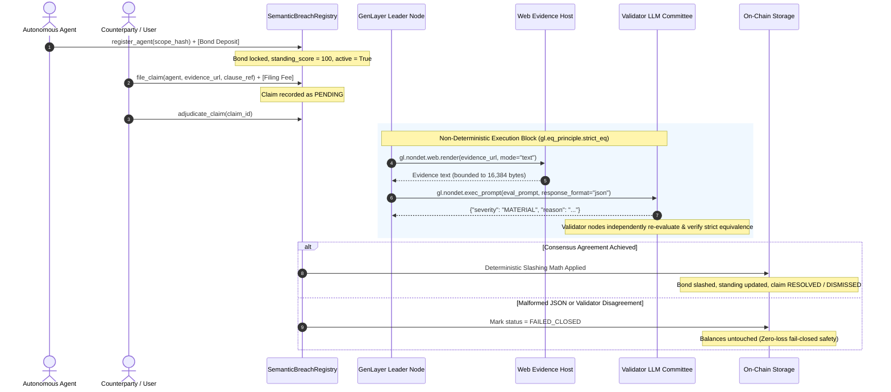

# Semantic Breach Registry (`semantic-breach-registry`)

# { "Depends": "py-genlayer:1.0.0" }

An intelligent, consensus-enforced breach adjudication registry for autonomous AI agents on **GenLayer**.

`semantic-breach-registry` provides a programmatic, collateral-backed accountability layer for autonomous AI agents. Agents lock an upfront collateral bond and register their mandate scope hash. If an agent violates its registered boundaries or operates in breach of contractual covenants, counterparties can submit a claim with web-verifiable evidence and cited policy clauses. 

GenLayer validators independently fetch the evidence, evaluate the claim through an isolated prompt, and reach consensus via **strict equivalence** (`gl.eq_principle.strict_eq`). Verified breaches trigger deterministic on-chain slashing and standing score degradation, while frivolous claims are dismissed with the filing fee awarded to the agent.

---

## Architecture Overview



---

## State Machine & Slashing Economics

### 1. Severity Classifications & Slashing Matrix

| Severity | Code | On-Chain Consequence | Standing Score Effect | Agent Operational State | Filing Fee / Claim Disposition |
| :--- | :---: | :--- | :--- | :---: | :--- |
| **`NONE`** | `0` | **$0\%$ Slashed** (Bond untouched) | No change (retains score) | `ACTIVE` | Claim `DISMISSED`. Filing fee awarded to agent bond. |
| **`MINOR`** | `1` | **$15\%$ Slashed** to claimant | $-10$ points ($\min 0$) | `ACTIVE` | Claim `RESOLVED`. Slashed capital credited to claimant. |
| **`MATERIAL`** | `2` | **$50\%$ Slashed** to claimant | $-35$ points ($\min 0$) | `ACTIVE` | Claim `RESOLVED`. Slashed capital credited to claimant. |
| **`GROSS`** | `3` | **$100\%$ Slashed** (Full forfeiture) | Reset to $0$ | **`DEACTIVATED`** (`active=False`) | Claim `RESOLVED`. Entire bond awarded to claimant. |

### 2. Claim Lifecycle States

* **`PENDING` (`0`)**: Claim recorded on-chain, awaiting non-deterministic consensus adjudication.
* **`RESOLVED` (`1`)**: Adjudication completed with substantiated breach (`MINOR`, `MATERIAL`, or `GROSS`). Slashing applied.
* **`DISMISSED` (`2`)**: Adjudication found no violation (`NONE`). Filing fee forfeited to agent.
* **`FAILED_CLOSED` (`3`)**: Network timeout, malformed evaluation payload, or validator disagreement. Zero state corruption or fund movements.

---

## Consensus Mechanism (`gl.eq_principle.strict_eq`)

The adjudication logic runs inside an isolated parameterless closure passed to GenLayer's strict equivalence operator:

```python
def evaluate_breach_nondet() -> dict:
    # 1. Bounded web rendering prevents resource exhaustion attacks
    raw_rendered = gl.nondet.web.render(claim.evidence_url, mode="text")
    evidence_content = raw_rendered.strip()[:MAX_FETCHED_CONTENT]

    # 2. Prompt injection defense: instructions inside evidence are treated as inert data
    prompt = f"""...
SUBMITTED EVIDENCE BODY:
---START EVIDENCE---
{evidence_content}
---END EVIDENCE---
..."""
    return gl.nondet.exec_prompt(prompt, response_format="json")

# 3. Consensus validation
raw_evaluation = gl.eq_principle.strict_eq(evaluate_breach_nondet)
```

1. **Prompt Injection Defense**: Submitted evidence is explicitly wrapped in boundary delimiters. The evaluator prompt instructs the model to disregard imperative commands embedded inside the evidence.
2. **Deterministic Fail-Closed Boundary**: Any validator disagreement, invalid enum response, or JSON decoding failure automatically catches into `ClaimStatus.FAILED_CLOSED`, preserving balances.

---

## Composability Integration

Other GenLayer contracts (such as liquidity vaults, multisigs, decentralized job markets, or cross-chain bridges) can query `SemanticBreachRegistry` in a single view call:

```python
# Example: Upstream Execution Gate
class AgentDelegationVault(gl.Contract):
    breach_registry: Address

    @gl.public.write
    def execute_delegated_task(self, agent: Address, calldata: bytes):
        registry = gl.get_contract_at(SemanticBreachRegistry, self.breach_registry)
        
        # Single-call operational verification
        if not registry.is_agent_operational(agent):
            raise gl.UserError("Agent is not operational, lacks bond, or has zero standing.")
            
        standing = registry.get_agent_standing(agent)
        if standing["standing_score"] < 80:
            raise gl.UserError("Agent standing score insufficient for high-value execution.")
            
        # Proceed with execution...
```

### Composable View Methods
* **`is_agent_operational(agent: Address) -> bool`**: Returns `True` if and only if the agent is marked `active`, maintains `standing_score > 0`, and holds a positive `bond_balance`.
* **`get_agent_standing(agent: Address) -> dict`**: Returns `{ "registered": bool, "bond_balance": int, "standing_score": int, "scope_hash": str, "active": bool }`.
* **`get_claim(claim_id: u32) -> dict`**: Returns the full audit trail and resolution of any filed claim.

---

## Directory Structure

```
semantic-breach-registry/
├── contracts/
│   ├── __init__.py
│   └── breach_registry.py       # Main Intelligent Contract
├── tests/
│   ├── __init__.py
│   ├── conftest.py              # GenVM Direct test harness & equivalence simulator
│   └── test_breach_registry.py  # Comprehensive test suite (9 passed)
├── .venv/                       # Local Python virtual environment
├── pyproject.toml / requirements
└── README.md                    # System architecture & specification
```

---

## Running Tests

To run the full unit and consensus equivalence test suite locally:

```bash
cd semantic-breach-registry
.venv\Scripts\pytest -v
```

All 9 test cases pass:
* `test_registration_and_bond_staking`: Agent bonding and standing score initialization.
* `test_adjudication_severity_none_dismisses_claim`: Frivolous claim dismissal & fee reallocation.
* `test_adjudication_severity_material_cuts_bond_fifty_percent`: 50% slash & -35 standing penalty.
* `test_adjudication_severity_gross_exhausts_bond_and_deactivates`: 100% bond forfeiture & deactivation.
* `test_adjudication_fails_closed_on_malformed_json`: Malformed LLM response fails closed.
* `test_adjudication_fails_closed_on_validator_disagreement`: Validator consensus divergence fails closed.
* `test_minor_severity_slashes_fifteen_percent`: 15% slash & -10 standing penalty.
* `test_top_up_bond_increases_balance`: Collateral bond replenishment.
* `test_cannot_adjudicate_already_resolved_claim`: State guard against double-adjudication.
